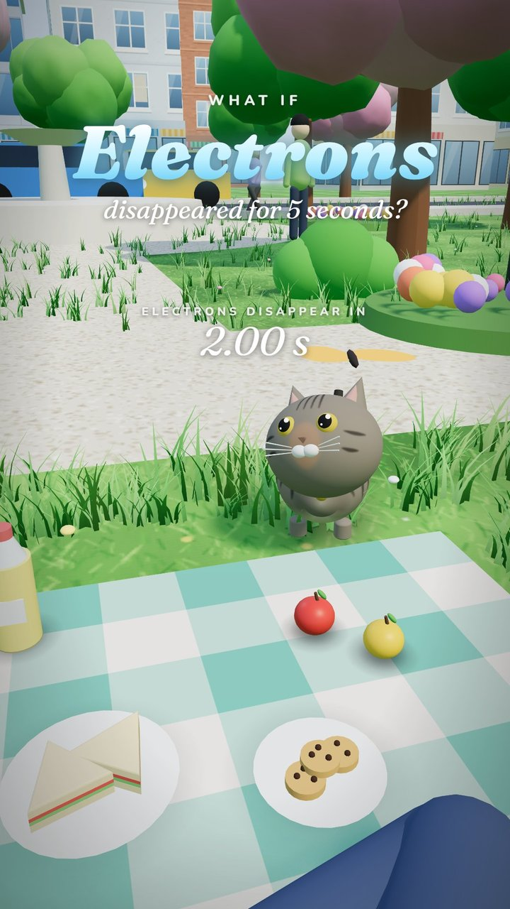
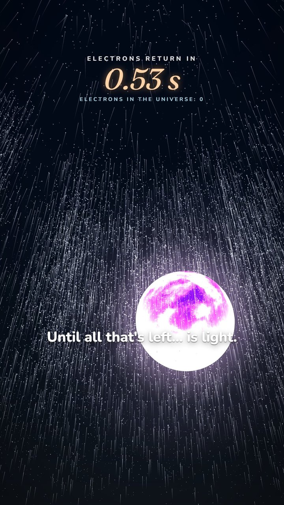
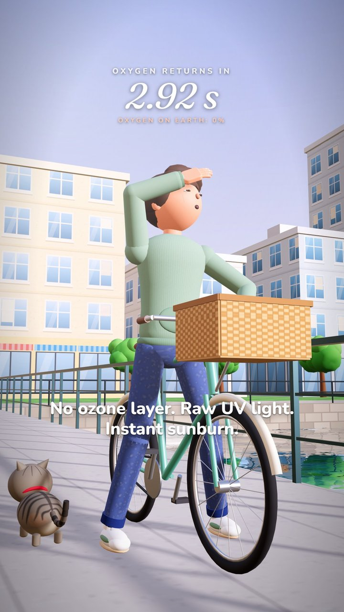
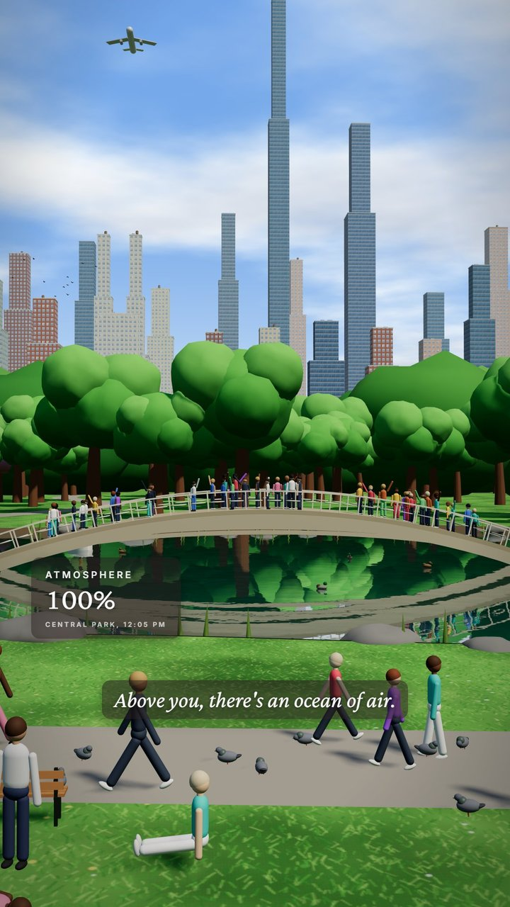
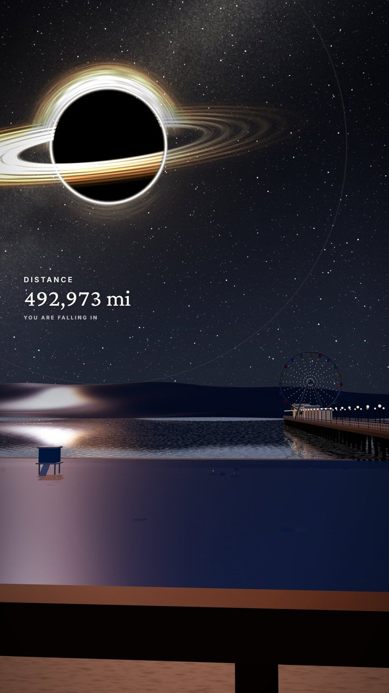

<h1 align="center">AI Video Studio — code-driven short-form video</h1>

<p align="center">
  Remotion 4 · React 19 · TypeScript · three.js (React Three Fiber) · Python (faster-whisper, numpy/scipy) · ffmpeg
</p>

> **Portfolio excerpt — not the full source.** This repository contains a small selection of files from my
> private video studio so reviewers can see how I write code. The voices, images, music, most scenes and the
> render setup are intentionally left out. All rights reserved (see [LICENSE](LICENSE)).

<p align="center">
  
  
  
  
  
</p>
<p align="center"><sub>Review frames from the "What if…" series, rendered from code (1080×1920, scaled down)</sub></p>

## What it is

A video studio where every short is a React component. I write the scene in TypeScript, Remotion turns it into
frames, and the whole video (3D scenes, captions, sound effects, music) can be re-rendered from the source at any time.

I use it to make vertical videos for my TikTok channels:

- **"What if…" series** — 3D low-poly explainers ("What if electrons disappeared for 5 seconds?",
  "What if oxygen disappeared for 5 seconds?", "What if the Sun turned into a black hole?"). Every scene is built in code with three.js:
  cities, parks, beaches, crowds, a cat, particles, a black hole. Episodes exist in English and Spanish.
- **Narrated story shorts** in Spanish — AI-generated clips cut to the narration, with an infographic-style HUD and
  word-by-word captions.

## Pipeline

```
idea → script → voice → Whisper word timings → Remotion / three.js scenes → synthesized audio → render
```

1. **Script.** I write the narration and plan the beats (what is on screen during each line).
2. **Voice.** The narration is generated with AI text-to-speech (ElevenLabs).
3. **Word timings.** `scripts/words.py` runs faster-whisper on the narration and writes the start/end time of
   every word to JSON. For story shorts, `pipeline/.../align.py` lines Whisper's words up against the original script
   with `difflib`, so the captions keep the exact spelling and punctuation of the script and any word Whisper missed
   gets an interpolated time.
4. **Scenes.** Remotion compositions (1080×1920, 30 fps). The 3D scenes use React Three Fiber inside Remotion; everything
   is a pure function of the frame number, so any frame can be rendered in any order, in parallel.
5. **Audio.** Music beds and sound effects are synthesized from scratch in Python with numpy/scipy (no sample packs):
   additive synthesis with vowel formants, filtered noise, convolution reverb. `build_dialog.py` splices character
   lines into the narration at specific words and shifts every caption timing after the insert.
6. **Render.** `npx remotion render` with WebGL through ANGLE, then ffmpeg normalizes loudness to −16 LUFS.
   `render-frames.mjs` renders single review frames (like the images above) from one bundle, for quick visual QA.

## Status

| | |
|---|---|
| Started | September 5, 2026 |
| "What if…" series | Built in October 2026 |
| Still in development? | **Yes**: new episodes and formats are added regularly |
| Size | 100+ Remotion compositions; the "What if…" series alone is about 27,000 lines of TypeScript |

## Channels

| Channel | What's there |
|---|---|
| [@secuencia007](https://www.tiktok.com/@secuencia007) — SecuencIA | AI short stories featuring a glass-skeleton character. 11.7K followers, 974.8K likes; one video passed 7.3M views, pinned videos have 1.1M and 917K |
| [@sinestesia777](https://www.tiktok.com/@sinestesia777) | Newer channel: the 3D "What if…" series |

<sub>Follower and view counts as of October 2026.</sub>

## Videos

Finished videos are linked from my portfolio site:

- **[Watch the "What if…?" videos on my portfolio](https://cristiancelie.vercel.app/#contenido)**: 12 vertical shorts rendered with this pipeline (black hole over Times Square, Miami without humans, Earth stops spinning, no electrons…), plus a 3D ad for blu.live.
- TikTok: [@sinestesia777](https://www.tiktok.com/@sinestesia777) (the 3D series) and [@secuencia007](https://www.tiktok.com/@secuencia007) (11.7K followers, one video at 7.3M views).

## Tech stack

**Video:** Remotion 4.0, React 19, TypeScript, @remotion/three, React Three Fiber, three.js (custom GLSL shaders,
instancing, EffectComposer passes: bloom, depth of field, ambient occlusion), Google Fonts via @remotion/google-fonts.

**Audio and tooling:** Python, faster-whisper (word timestamps), numpy, scipy.signal (Butterworth filters,
FFT convolution), ffmpeg (trimming, loudness normalization), Node scripts on @remotion/renderer.

## What's in this excerpt

| File | What it shows |
|---|---|
| `src/whatif/fx/Particles.tsx` | Deterministic GPU particles: position, turbulence and fade computed in the vertex shader from time alone, so frames render out of order; optional procedural smoke puffs |
| `src/whatif/fx/dissolve.ts` | Matter "dissolving" effect: patches three.js standard materials with a noisy spherical front, glowing edge and a desaturation pass; exponential front with an inverse to schedule events |
| `src/whatif/world/People.tsx` | Instanced low-poly crowds (hundreds of people, 11 parts each) with poses: walk, sit, lie, swim, wave |
| `src/whatif/ui.tsx` | Shared on-screen text for the series: title card, countdown HUD, subtitles |
| `scripts/words.py` | faster-whisper word-level timestamps to JSON |
| `scripts/whatif_audio.py` | A slow-motion cat meow (formant synthesis with a falling pitch), ambient pad, rising drone and dust sweep, all synthesized |
| `render-frames.mjs` | Renders chosen frames of any composition for review, with WebGL via ANGLE |
| `pipeline/apagon/trabajo/align.py` | Aligns the script to Whisper's words with `difflib` and fills gaps by interpolation |
| `pipeline/telefono/trabajo/build_dialog.py` | Inserts character lines into the narration and re-times every caption after each insert |
| `pipeline/coma/p2-trabajo/make_sfx.py` | Procedural SFX: rifle shot, rain loop, engine start, motorbike sputter, crowd growls, sniffing |

Comments and on-screen text are mostly in Spanish. Local folder paths in the pipeline scripts were replaced with
placeholders such as `<REMOTION_STUDIO_DIR>`.

**Not included on purpose:** the episode compositions and 3D worlds, the voices, images, AI clips and music, the
prompts, the render and delivery scripts, client and ad work, and anything personal. The excerpt can't be built or run.

---

Built by **Cristian Luis Celie**: [GitHub profile and CV](https://github.com/keblardo) · cristiancelie07@gmail.com
